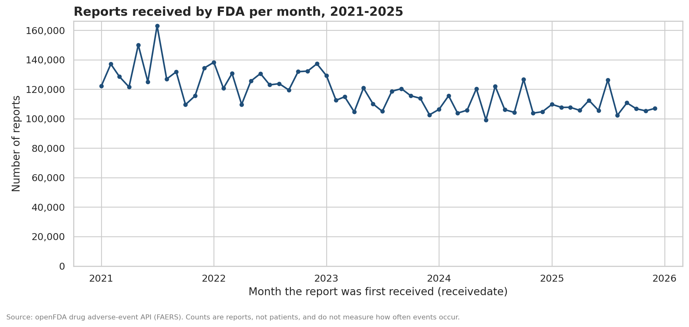
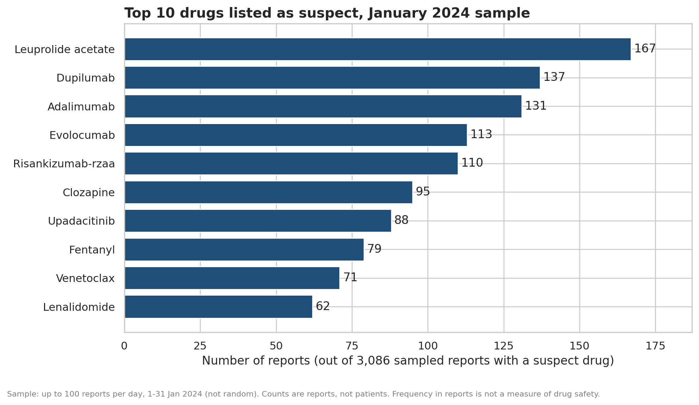
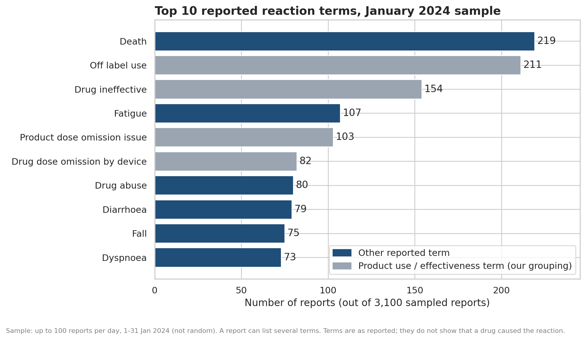
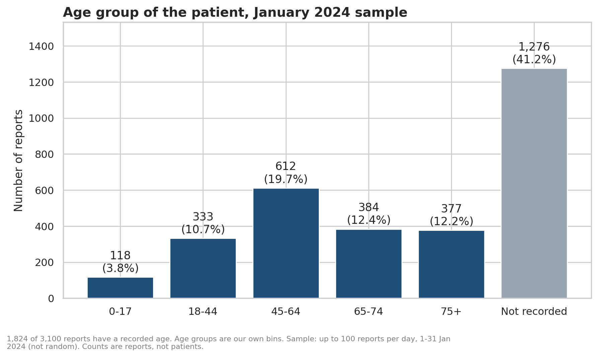
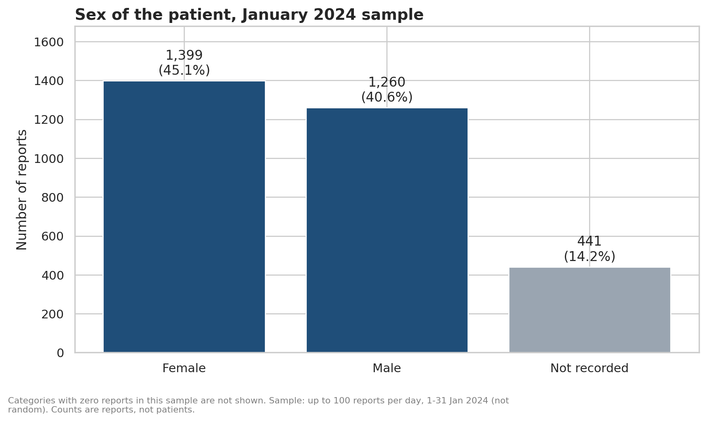
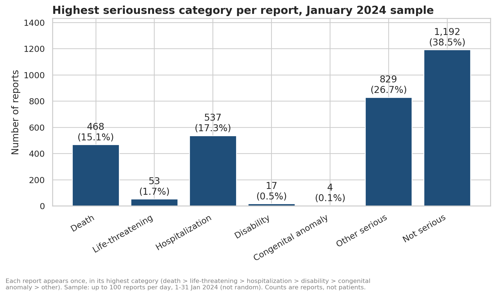
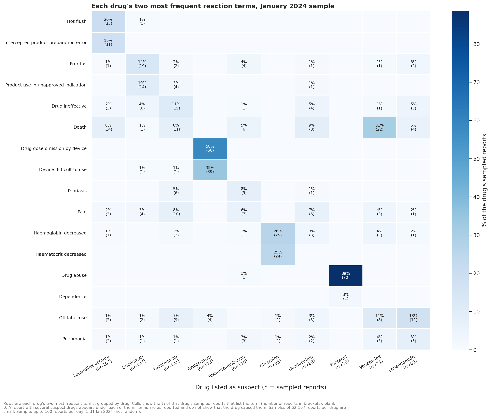

# Pharmaceutical Adverse Event Analysis Using FDA Public Data

A descriptive analysis of drug adverse-event reports from the openFDA drug adverse-event API (FAERS data), built with Python, pandas, Matplotlib/Seaborn and MySQL.

> **Read this first.** Adverse-event reports do not establish that a drug caused a reaction, may be incomplete or duplicated, and cannot be used to calculate how often an event occurs. This project describes what was *reported*. It does not rank drugs by danger, estimate risk or give clinical advice. openFDA itself describes its results as unvalidated and not for use in medical-care decisions.

## At a glance

| | |
|---|---|
| Data | openFDA drug adverse-event API (FAERS), reports first received 1-31 January 2024 |
| Content sample | 3,100 of 106,399 reports (2.9%): up to 100 per day, in the order the API returned them. Stratified by day, **not random** |
| Volume trend | True daily report counts for 2021-2025 (7,085,259 reports) from the API's `count` aggregation |
| Counting unit | One report (`safetyreportid`). Never patients |
| Tools | Python 3.13, pandas, NumPy, Matplotlib, Seaborn, SQLAlchemy, PyMySQL, MySQL 8.0, Google Colab, Git |

## Objective

Turn raw, nested adverse-event data into clean, correctly countable tables, and summarise them responsibly. The project answers seven descriptive questions and documents what the data can and cannot support.

| # | Question | Where answered |
|---|---|---|
| 1 | How do report counts vary over time? | Notebook 03 (Finding 1), chart 1, SQL Q7 |
| 2 | Which drugs appear most often in reports? | Notebook 03 (Finding 2), chart 2, SQL Q3 |
| 3 | Which reactions are reported most often? | Notebook 03 (Finding 3), chart 3 |
| 4 | What age and sex distributions are available? | Notebook 03 (Finding 4), charts 4-5, SQL Q1 |
| 5 | What outcomes are recorded most often? | Notebook 03 (Finding 5), chart 6, SQL Q2, Q4 |
| 6 | How do reported reactions vary by drug? | Notebook 03 (Finding 6), chart 7, SQL Q6 |
| 7 | What data-quality issues could affect the findings? | Notebook 03 (Finding 7), [limitations](docs/limitations.md) |

## Key results

All results are for the sample described above, counted in unique reports. Full detail, with limits for each finding, is in [docs/findings.md](docs/findings.md).

- **Volume.** Reports received by FDA per year fell from 1,566,148 (2021) to 1,307,769 (2025), a 16.5% decrease, with 2024 and 2025 close to flat. This describes reports received, not how often events occurred.
- **Drugs.** Leuprolide acetate was listed as suspect in 167 of 3,086 sampled reports that name a suspect drug (5.4%). Seven of the top ten drugs stay in the top ten when follow-up reports, or reports listing duplicate identifiers, are excluded. Frequency in reports is not a measure of safety.
- **Reactions.** DEATH (219 reports, 7.1%) and off label use (211, 6.8%) are the most frequent reaction terms. Four of the top ten terms describe product use or effectiveness rather than a clinical symptom.
- **Demographics.** Age is recorded in 58.8% of reports (median 61) and sex in 85.8%.
- **Seriousness.** 61.5% of sampled reports carry a seriousness flag, and 468 (15.1%) carry the death flag. The death flag (468 reports) and the DEATH reaction term (219 reports) are different fields and are never added together.
- **Drug mix can create apparent group differences.** In the 45-64 age group the death-flag share is 20.9%; excluding the 69 reports that list fentanyl as suspect it is 11.2%.
- **Data quality shapes every result.** Age is missing in 41.2% of reports, 27.4% of drug entries repeated a drug already listed in the same report, and 57.2% of reaction entries have an unknown or unrecorded outcome.

## Charts















## How counting works

One report can list many drugs and many reactions (one sampled report lists 259 drug entries). Combining them in one table multiplies rows: joining the drug rows of 168 leuprolide acetate reports to their reaction rows gives 475 rows. This project keeps reports, drugs and reactions in separate tables linked by `safetyreportid`, collapses repeated entries inside a report, and counts unique reports (`COUNT(DISTINCT safetyreportid)`) with the denominator stated on every chart.

## Repository structure

```
openfda-adverse-event-analysis/
├── README.md
├── requirements.txt
├── .gitignore
├── LICENSE
├── notebooks/
│   ├── 01_data_collection.ipynb      API sample, provenance, extraction to three tables
│   ├── 02_data_cleaning.ipynb        dates, age units, categories, duplicates, counting tables
│   ├── 03_exploratory_analysis.ipynb questions 1-7, charts, findings 1-7
│   └── 04_sql_analysis.ipynb         MySQL load, reconciliation, queries Q1-Q10, findings 8-11
├── sql/
│   ├── schema.sql                    four tables, keys, comments
│   └── queries.sql                   Q1-Q10 (GROUP BY, JOIN, CASE, CTEs, window functions)
├── outputs/
│   ├── figures/                      PNG charts used above
│   └── tables/                       summary CSVs behind the charts and SQL results
└── docs/
    ├── data_dictionary.md
    ├── findings.md
    ├── methodology.md
    └── limitations.md
```

Raw and processed data (`data/`) are not committed; the notebooks download and rebuild them.

## SQL analysis

`sql/schema.sql` defines `reports` (one row per report), `report_drugs` (one row per distinct drug per report), `report_reactions` (one row per distinct reaction term per report) and `daily_report_counts` (true daily volumes). After loading, 12 reconciliation checks compared the database with the pandas results before any query was run, and all passed.

`sql/queries.sql` holds ten queries, all executed on the loaded data:

| Query | Technique | Question |
|---|---|---|
| Q1 | GROUP BY, CASE | Reports by age group |
| Q2 | GROUP BY, conditional CASE | Serious and death-flag shares by age group |
| Q3 | JOIN | Top 10 suspect drugs with death-flag counts |
| Q4 | LEFT JOIN, CASE | DEATH reaction term versus death flag |
| Q5 | JOIN | Row inflation when drugs are joined to reactions |
| Q6 | CTEs, ROW_NUMBER | Top 3 reaction terms per top-10 drug |
| Q7 | CTE, LAG, moving average | Monthly volume and change versus the previous year |
| Q8 | CTEs, DENSE_RANK | Most frequent suspect drugs within each age group |
| Q9 | CTE, EXISTS | Death-flag share by age group with and without fentanyl-suspect reports |
| Q10 | CTE, EXISTS | Fentanyl-suspect reports by DRUG ABUSE term and death flag |

## Reproducing the analysis

Developed and run in Google Colab (Python 3.13, MySQL 8.0.46). It has not been tested outside Colab. No API key was needed: the whole pipeline makes about 40 API requests.

1. Create a Google account folder for outputs: the notebooks write to `My Drive/openfda-project/` (they create the subfolders).
2. Open each notebook in Colab and run its cells top to bottom, in this order:
   1. [01_data_collection](https://colab.research.google.com/github/KarenInfanta/openfda-adverse-event-analysis/blob/main/notebooks/01_data_collection.ipynb): downloads the sample and saves raw and extracted data to Drive.
   2. [02_data_cleaning](https://colab.research.google.com/github/KarenInfanta/openfda-adverse-event-analysis/blob/main/notebooks/02_data_cleaning.ipynb)
   3. [03_exploratory_analysis](https://colab.research.google.com/github/KarenInfanta/openfda-adverse-event-analysis/blob/main/notebooks/03_exploratory_analysis.ipynb): also fetches true daily counts for 2021-2025.
   4. [04_sql_analysis](https://colab.research.google.com/github/KarenInfanta/openfda-adverse-event-analysis/blob/main/notebooks/04_sql_analysis.ipynb): installs MySQL inside the Colab session (about two minutes), loads the clean tables and runs the queries.
3. To work locally instead, run `pip install -r requirements.txt` and change the Drive paths at the top of each notebook; you must also provide a MySQL 8.0 server.

openFDA updates its data quarterly, and the API may lag by three months or more, so a later run can differ slightly from the numbers shown here. Each raw file records the retrieval time and the openFDA "last updated" date.

## Methodology and limitations

- [docs/methodology.md](docs/methodology.md): sampling design, cleaning rules, counting rules, duplicates and follow-ups, sensitivity checks, quality assurance, and problems found and fixed.
- [docs/data_dictionary.md](docs/data_dictionary.md): source fields, code meanings and derived columns.
- [docs/limitations.md](docs/limitations.md): what the data and this analysis cannot support.

## Future improvements

- Add further months and test whether rankings and patterns repeat.
- Check whether clusters (such as the fentanyl reports) concentrate on certain days or submitters.
- Improve drug-name normalisation, including combination products.
- Group reaction terms into documented categories.
- Move the cleaning steps into tested functions in a `src/` package so the analysis rebuilds from one script.

## Data source and attribution

Data: U.S. Food and Drug Administration, [openFDA drug adverse-event API](https://open.fda.gov/apis/drug/event/), derived from the [FDA Adverse Event Reporting System (FAERS)](https://www.fda.gov/drugs/drug-approvals-and-databases/fda-adverse-event-reporting-system-faers-database). This is an independent portfolio project. It is not affiliated with or endorsed by the FDA, and it is not related to any employer. Use of the API is subject to openFDA's terms of service. No raw data are redistributed here.

## Author

Karen Infanta, BE Computer Science graduate (2026), interested in healthcare data analytics.
[LinkedIn](https://www.linkedin.com/in/karen-infanta-248040259/) | [GitHub](https://github.com/KarenInfanta)

## License

Code and documentation are released under the MIT License (see `LICENSE`). The license does not cover the FDA data.
